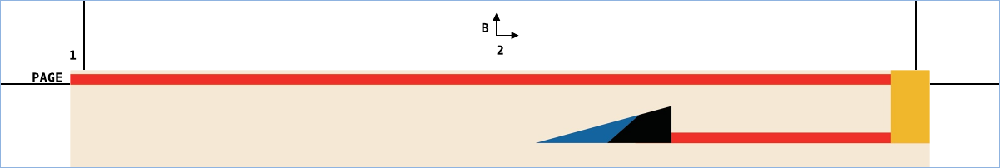

**pdftilecut** lets you sub-divide a PDF page(s) into smaller pages so you
can print them on small form printers. This operation is sometimes called
*posterizing* (related to printing large posters on home printers) and
*[tile cropping](http://www.imagemagick.org/Usage/crop/#crop_tile)*.

> This is a fork of [oxplot/pdftilecut](https://github.com/oxplot/pdftilecut).
> It adds the `-no-outer-marks` option and uses narrower tile margins
> (see [Changes in this fork](#changes-in-this-fork)).

# Installation

A statically linked Linux (x86-64) binary is available on the [releases
page](https://github.com/kfhermes/pdftilecut/releases). 

# Features

* Statically linked Linux binary with no dependencies.
* Multi page PDF support. Each page can be of arbitrary size.
* Each output page has appropriate PDF bleed and trim boxes set (so you
  can give it to a printing house and get back correctly trimmed pages).
* Print marks to assist with accurate trimming and arranging.
* New in this fork: Do not print marks or bleed on the outer edges of the poster, so the
  finished poster only needs trimming where tiles meet.

# Usage

We want to print `mars.pdf` from the [beautiful NASA
posters](https://www.jpl.nasa.gov/galleries/visions-of-the-future)
collection, which comes in 20x30 inch size, on A4 papers. To keep the
outer edges of the finished poster clean, so that it only needs trimming
where tiles meet:

```sh
$ pdftilecut -tile-size A4 -no-outer-marks -in mars.pdf -out mars_a4.pdf
```

More examples:

```sh
# Bleed and trim marks on all four sides of every tile
$ pdftilecut -tile-size A4 -in mars.pdf -out mars_a4.pdf

# Custom tile size and title, reading from stdin and writing to stdout
$ pdftilecut -tile-size "10cm x 15cm" -title "Mars" -no-outer-marks < mars.pdf > mars_tiles.pdf

# Trim lines across the full width/height of each tile, for cutting with a guillotine or long ruler
$ pdftilecut -tile-size A5 -long-trim-marks -no-outer-marks -in mars.pdf -out mars_a5.pdf
```

**Warning: if printing, ensure your print settings are not re-scaling
the output (e.g. Scale to fit option must be off, and scale set to
100%). Always start with a single page and ensure dimensions are
correct before printing all tiles.**

Below on the left is the original poster, and on the right its top-left
and top-middle tiles from the first command above. Their top and left
edges, which are outer edges of the poster, have only a narrow white
margin with no marks:


The margins of each tile carry the original page number ("PAGE 1"), the
title (at the bottom) and a tile reference (row letter, column number)
for easier arranging. Here is the top margin of the centre tile:



*Example poster: "Visions of the Future: Mars", NASA/JPL-Caltech, public
domain ([Wikimedia
Commons](https://commons.wikimedia.org/wiki/File:JPL_Visions_of_the_Future,_Mars.jpg)).*

## Options

| Option | Description |
| --- | --- |
| `-in FILE` | Input PDF (default: stdin) |
| `-out FILE` | Output PDF (default: stdout) |
| `-tile-size SIZE` | Maximum tile size including margins. A paper size (e.g. `A4`, `A5`, `Letter`) or `width x height` with a unit of `mm`, `cm`, `in` or `pt` (e.g. `"6cm x 12in"`). Default `A4`. |
| `-title TEXT` | Title printed in the margin of each tile (default: input filename) |
| `-long-trim-marks` | Draw trim marks across the full width/height of the tile |
| `-no-outer-marks` | On the outer edges of the original page, drop the bleed and trim marks and use a narrow white margin (see below) |
| `-debug` | Run in debug mode |

## Clean outer edges with `-no-outer-marks`

By default every tile has a bleed area and trim marks on all four sides.
With `-no-outer-marks`, the sides of a tile that lie on the outer edge of
the original page (sides with no neighbouring tile) instead get:

* no bleed and no trim marks,
* an 8pt (≈2.8mm) white margin, so those tiles are smaller pages,
* no page number or "PAGE" label (if the top or left side is an outer
  edge) and no title (if the bottom side is), as they don't fit in the
  narrow margin.

The tile reference (row letter and column number) is moved into the
margin of an inner side, which is cut off or covered by the neighbouring
tile when the poster is assembled. A page that fits on a single tile has
no inner side and gets no tile reference.

# Changes in this fork

* New `-no-outer-marks` option (see above).
* Narrower margins on every tile: the bleed margin is now 40pt (≈14mm,
  was 60pt) and the trim margin 8pt (≈2.8mm, was 12pt). Each tile
  therefore holds more of the poster, and **output from the same input
  and tile size differs from the original pdftilecut** (tile count and
  tile boundaries may change).


# Credits

pdftilecut was written by [oxplot](https://github.com/oxplot/pdftilecut).

The amazing [QPDF library](https://github.com/qpdf/qpdf) is used to
parse and write back modified PDF files. QPDF relies on
[libz](https://www.zlib.net) and
[libjpeg](https://github.com/libjpeg-turbo). Library sources are not
included in this repo and must be downloaded separately.
